# The aOS design charter

The rules every aOS app follows, new or old, so the suite looks and works the
same everywhere. Learn an app and you've learned them all.

Each rule says what it is, why it matters, what "done" looks like, and how it's
kept: **CI: `<check>`** is `node aOS/scripts/design-check.mjs` (it prints a
table, app by app, and fails on any miss); **Review** is a person, or a Claude
session, reading the change. Where apps disagree today, the rule says which way
is right and lists who doesn't follow it yet under **Known gaps**.

The pictures are real: `node aOS/scripts/design-shots.mjs` draws them from the
apps into `docs/design/` (and the "Don't"s from small snippets of the old
patterns). Run it again after changing how an app or a shared part looks, and
commit what it draws.

When this charter and an app disagree, the app is wrong. When this charter and
`CLAUDE.md` or `.claude/skills/new-aos-app/SKILL.md` disagree, say so: they
must say the same thing.

**Contents:** 1 Looks · 2 Type, spacing and corners · 3 Sheets · 4 Settings ·
5 Controls · 6 Words · 7 Ipsy · 8 Empty screens · 9 Toasts and Undo ·
10 Motion · 11 Light and dark · 12 Accessibility · 13 Icons · 14 Shared parts

---

## 1. Four looks, one app

**Every app has the four looks: Vintage (the default), Standard (Sea glass),
Layers and Tron; you write Vintage and Sea glass, and Layers and Tron are
generated from Vintage.**

- **Why:** a person picks a look once, in aOS (Account > Appearance), and every
  app wears it. One app that can't breaks the suite.
- **Done:** `home/design.js` loaded in `<head>` with the app's `data-app`; the
  page's main `<style>` is Sea glass, `<style id="vintage">` follows it, and
  `<style id="layers">` and `<style id="grid">` (Tron) are written by
  `node aOS/scripts/make-looks.mjs` from the Vintage block (palettes in
  `aOS/scripts/looks.mjs`), never by hand. Colours come from tokens (`--bg`,
  `--text`, `--muted`, `--accent`, `--cta`, and the shared `--st-*`), never
  from colours typed into a rule. No new colours or gradients: Sea glass is the
  four AllisonOS hues (sea glass `#6FA597`, mist `#8193BC`, shell `#BE918F`,
  sand `#BC9C68`); Vintage is cream and walnut, mustard, teal and burnt orange.
  Functional colours (danger, maps, weather) are fine.
- **Enforced:** CI: `check-apps.mjs` (the blocks are present and up to date)
  and `aOS/scripts/design-test.mjs` (every app opens in all four). The tokens:
  Review.

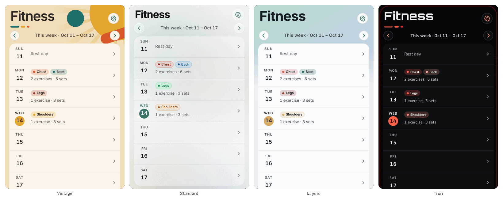

The tokens the shared parts take in each look, read from a real page:

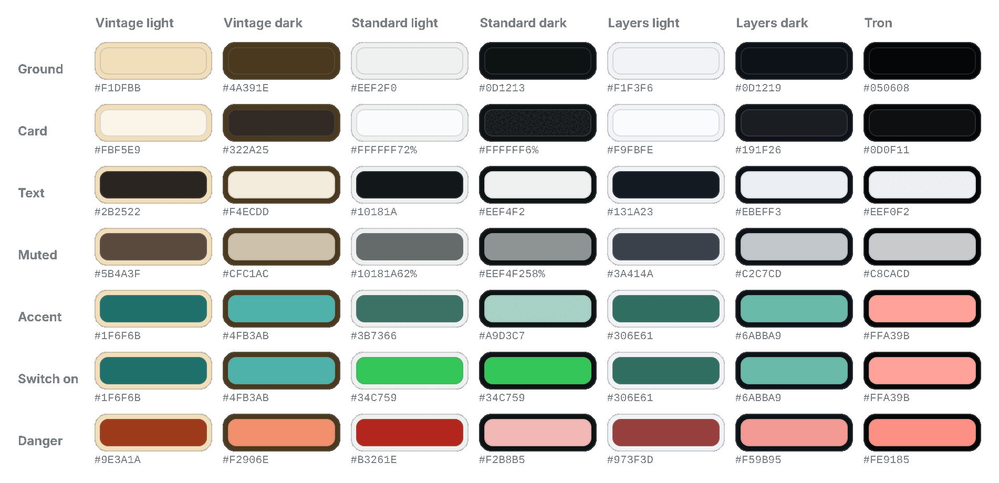

## 2. Type, spacing and corners

**The system font at a handful of sizes, rows at least 52 tall, groups with
corners of 20; take the sizes from the shared parts rather than choosing new
ones.**

- **Why:** the same sizes everywhere is what makes eleven apps feel like one.
- **Done:** in a sheet: the title 17 semibold; a section label 12 semibold
  capitals, `.12em` apart, muted (`.16em` in Vintage, `.2em` in Tron); a row's
  name 16 semibold, the line under it 13 regular, muted; the line under a
  section 12.5, muted. Rows are at least 52 tall with 16 in from the left;
  groups have corners of 20, a hairline edge and no shadow; 22 between
  sections. Sheets have corners of 28 (34 for the Liquid Glass `.lg` sheets);
  cards 22; pills and round buttons are fully round. The font is the system's
  (`-apple-system…`), or the look's own in Vintage and Tron, never one loaded
  from another site. These are `home/settings.js`'s numbers: use its classes
  and they're right.
- **Enforced:** Review (the shared parts carry the numbers; CI: `shared`
  checks Settings uses them).

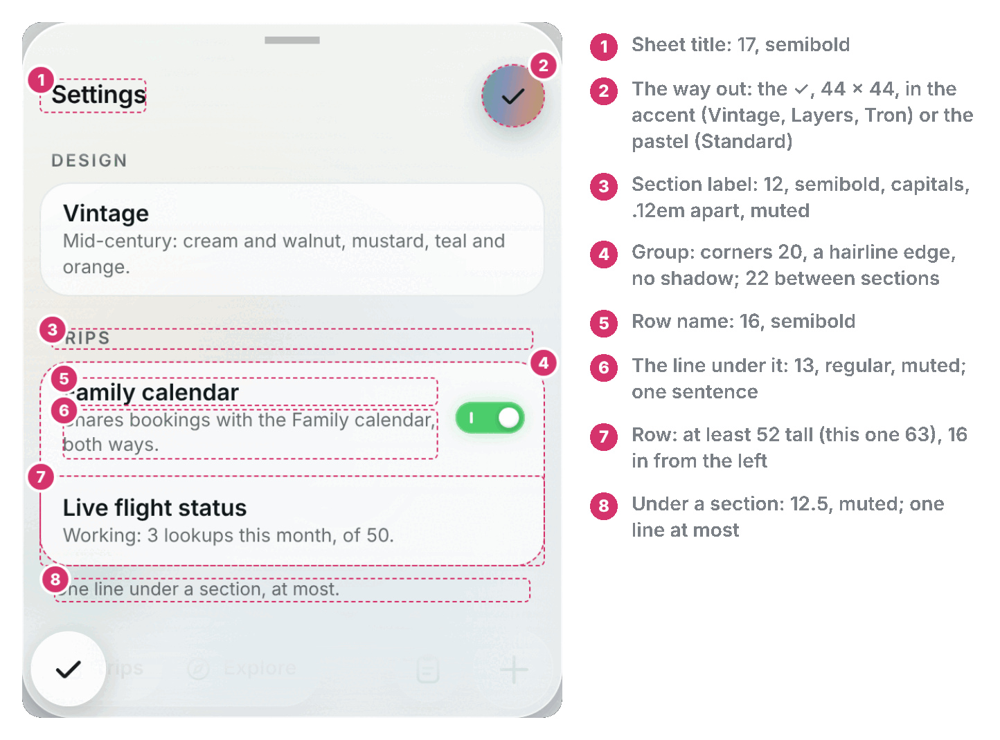

## 3. Sheets: a title, the ✓ in the corner, the way out within reach

**Everything you open is a sheet with a plain title, its way out in its head
(the ✓ labelled Done, or Back or Close), and that way out floating at the
bottom left too.**

- **Why:** you never hunt for how to get out, and on a big phone your thumb
  reaches it.
- **Done:** `role="dialog" aria-modal="true"`, named by its title
  (`aria-labelledby`). A sheet that just shows or sets things closes with the ✓
  (`aria-label="Done"`, 44 × 44, in the head's right corner, the look's
  main-button colour). A step inside another sheet has Back; an edit you can
  abandon has Cancel beside its Done. You don't add the floating button:
  `home/welcome.js` (`floatBack`) finds the way out among the head's buttons
  (Back, then Close, then a Done with no Cancel beside it) and floats a copy at
  the bottom left that presses the real one. A full-screen mode that isn't a
  page you go into takes `data-nofloat`. Settings's own title is "Settings"
  (rule 4).
- **Enforced:** CI: `done` (Settings's ✓ Done in the corner), `title`.
  Other sheets: Review.
- **Known gaps** (Settings): none; every app's Settings closes with the ✓.

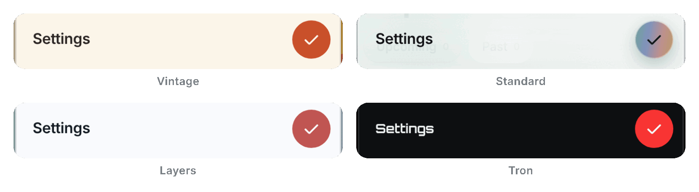

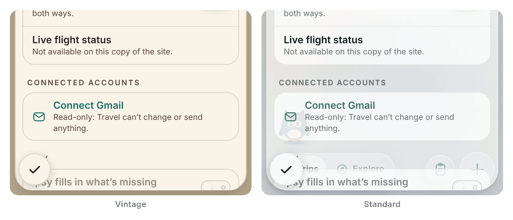

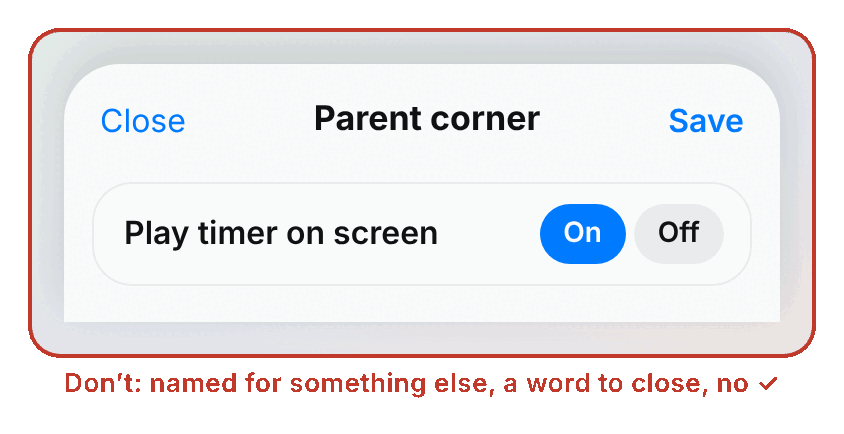

## 4. Settings: the standard

**Every app's Settings is the same sheet, built with `home/settings.js`:
called Settings, opened by a button labelled Settings, sections in one order,
the same kinds of row and the same words.**

- **Why:** learn Settings in one app and you know it in all of them; a fix to
  the component reaches every app at once.
- **Done:**
  - `<script src="../home/settings.js">` before the app's own script, and in
    `sw.js` SHELL. The body is `AllisonOS.settings` sections and rows; the look
    (and the switch) is the component's, never restyled in the app. Travel's
    `renderSettings` (`travel/app.js`) is the example to copy.
  - Opened from the main screen by a gear button labelled **Settings**
    (`aria-label="Settings"`), signed in or not. The sheet's title is
    **Settings**, in every app: not the app's name, "Places", "Parent corner"
    or "Home Assistant settings". Sparkle's stays behind its grown-up check.
  - The sections, in this order, leaving out what the app doesn't have:
    **Design** (always first: `aosDesign.picker()` in `S.raw`, bound with
    `aosDesign.bind`) · the app's own, named for what they're about (Trips,
    Family rules, Your goals) · **Connected accounts** · **Ipsy** ·
    **Notifications** · **Your data** · **Family account**. Notifications live
    here too (Notes' bell opens this section).
  - Rows: the kinds in rule 5. At most one line under a section (`hint`).
- **Enforced:** CI: `shared`, `title`, `design-first`, `order`.
- **Known gaps:** none. Allowed differences: Clock draws its own Design rows,
  as its looks live in `clock/design.js` (the check takes them); Sparkle's
  button, "Settings, for grown-ups", opens on a press and hold behind its
  grown-up sum; Mail shows its gear only once you're signed in to Gmail.

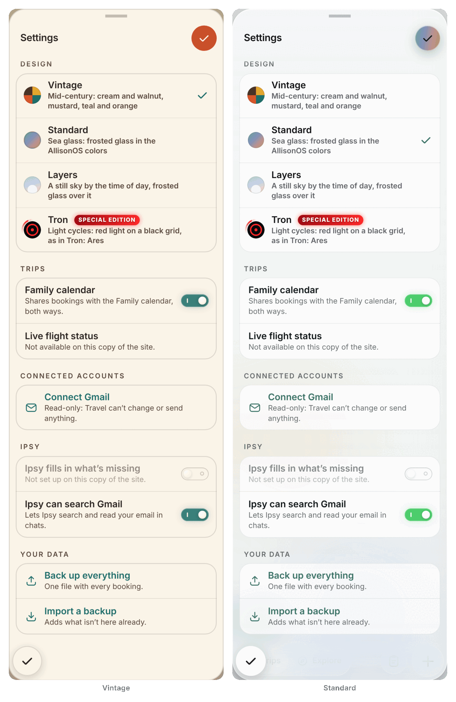

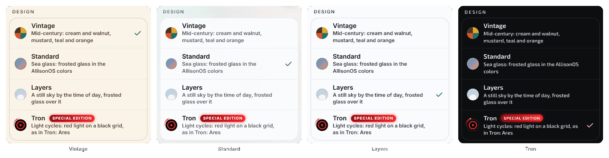

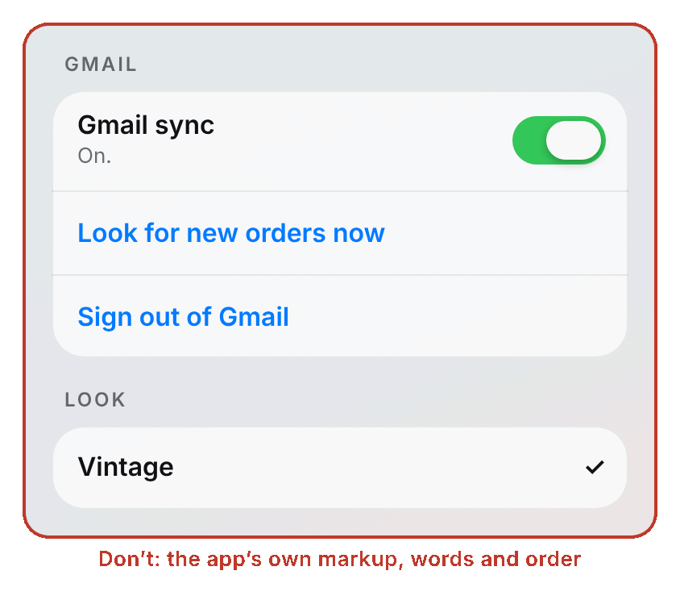

## 5. Controls: one kind of row for each job

**Pick the row by what it does: a switch for on or off, a choice for two or
three options, a select for four or more, an action for a verb, a danger row
that asks twice, an info row for how things stand.**

- **Why:** the same control for the same job means nobody has to read the
  screen to know how it works.
- **Done:** from `AllisonOS.settings` (`home/settings.js`):
  - **Switch** (`S.toggle`, flipped with `S.flip`): anything on or off. The
    Bead + Labeled switch, 48 × 22, a | in the track when on and an o when off,
    in the look's colour. Never On/Off buttons, a check mark, words, or a
    switch of your own. The whole row is the switch.
  - **Choice** (`S.choice`, read with `S.pick`): two or three options, a
    segmented control under the name.
  - **Select** (`S.select`): four or more, the value on the right. **Nav**
    (`S.nav`) opens more, with the value and a chevron.
  - **Action** (`S.action`): an icon and a verb, in the accent colour (Check
    now, Back up everything).
  - **Danger** (`S.danger`): deletes or signs out, in red, and asks again in
    place: the first tap turns it into "Tap again to confirm" for 4 seconds
    (`S.armed`). Never `confirm()`, `alert()` or `prompt()`: they look like the
    browser, not the app, and say "localhost says". Ipsy asks in its own chat
    (rule 7). Where a row can't ask twice (a list's Remove, a sheet's Send),
    ask in the app: `await S.ask({ title, text, yes, danger })`.
  - **Info** (`S.info`): how things stand, no tap.
  Outside Settings (an editor's Private, a filter) the same rules hold: an
  on/off is the shared switch, as a row (`S.toggle`) or on its own (`S.sw`,
  labelled for VoiceOver, tapped across 44 points).
- **Enforced:** CI: `switch-css` (no private copy of the switch's CSS),
  `no-dialogs`, `shared` (every switch in Settings is the shared one).
  Choosing the right kind: Review.
- **Known gaps:** none: every switch, in Settings and out, is the shared one,
  and no app calls `confirm()`. Home's device controls keep the Signal
  dashboard's switches (`CLAUDE.md`), so they are exempt.

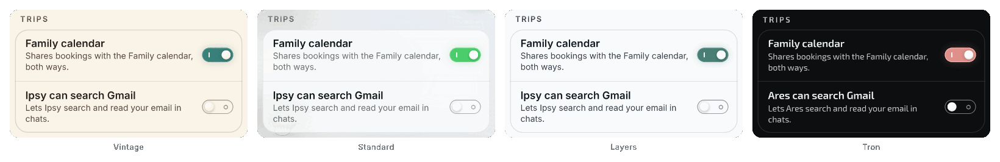

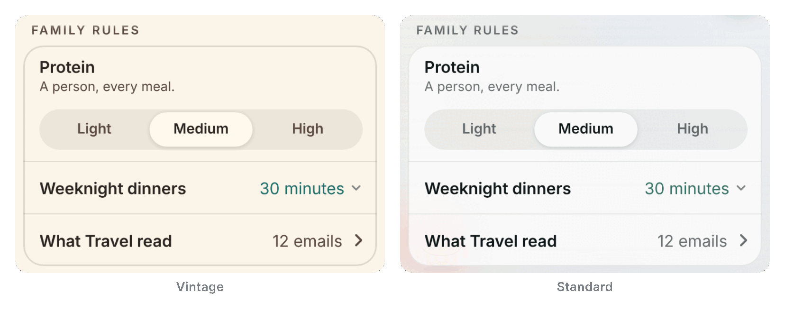

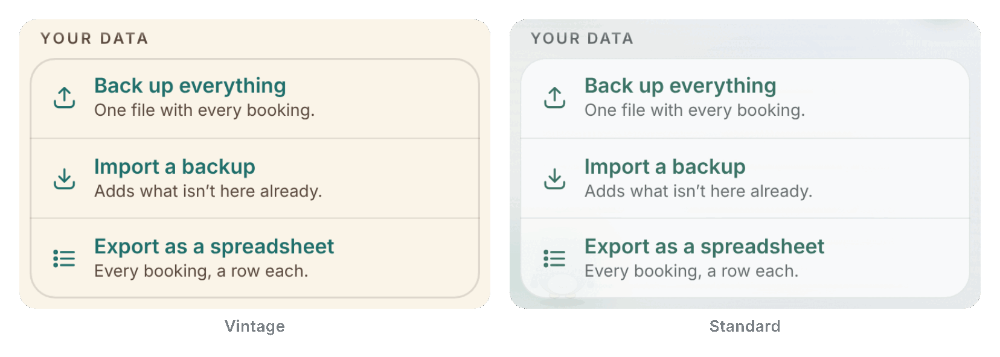

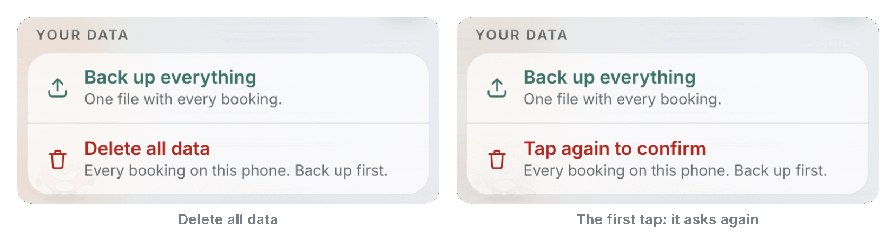

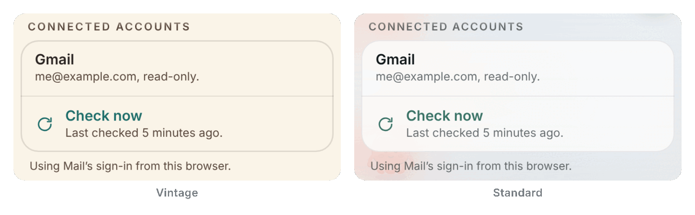

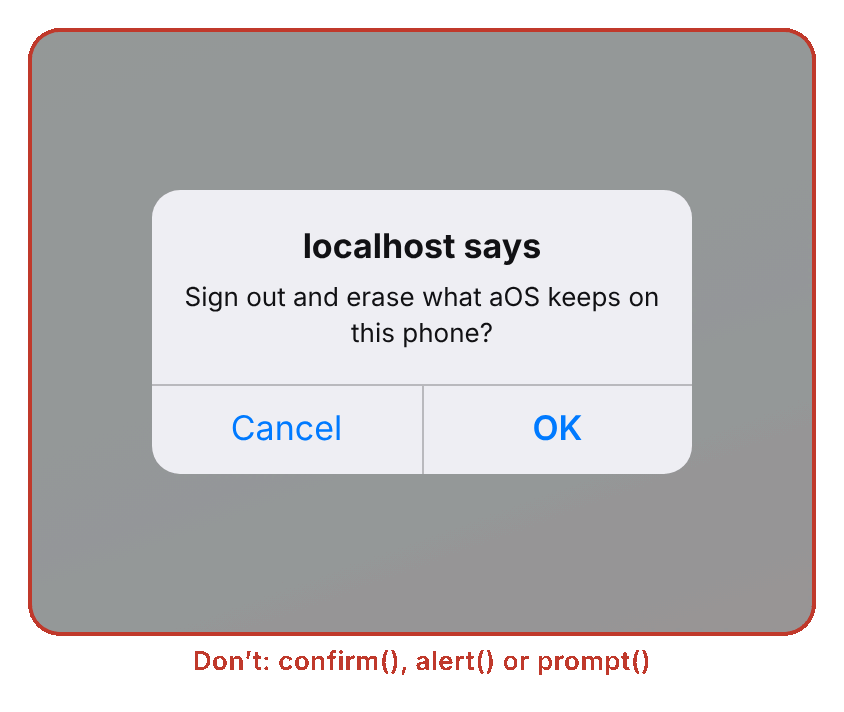

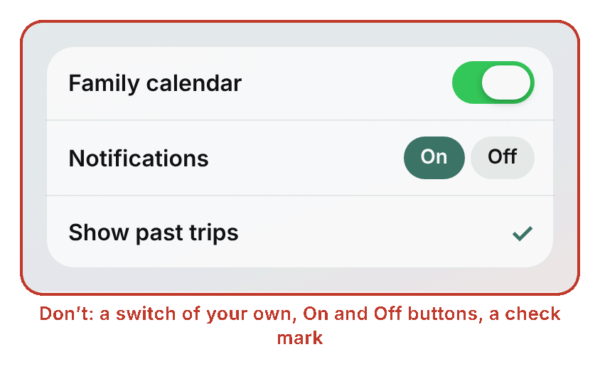

## 6. Words

**Plain, short, second person, US English; one sentence under a row, ending
with a full stop; never "On." or "Off."; the same words for the same job; aOS
with a lowercase a.**

- **Why:** the switch already says on or off, and the same job called five
  things looks like five different jobs.
- **Done:**
  - The line under a row says what it does, in one sentence ending with a full
    stop ("Shares bookings with the Family calendar, both ways."), or how it
    stands ("Last checked 5 minutes ago."). Not "On." or "Off.", not two
    sentences.
  - The same job, the same words: **Check now** · **Disconnect Gmail** ·
    **Back up everything** · **Import a backup** · **Export as a spreadsheet**
    · **Delete all data** · **Sign in with Face ID**, then **Signed in as
    Tom**.
  - US spelling and dates (`lang="en-US"`, `'en-US'` to `toLocaleDateString`:
    "Oct 9, 2026"). Stored keys keep their old spelling.
  - "aOS" always with a lowercase a, never uppercased by CSS (watch section
    labels, which are capitals). The helper's words say Ipsy, and
    `home/names.js` puts in the name the person gave it.
- **Enforced:** CI: `on-off`, `one-sentence`, `aos-case`. The same words:
  Review.
- **Known gaps:** none in Settings today. Outside it, Orders' and Travel's
  Gmail button is labelled "Look for new orders (bookings) in Gmail", which is
  fine: it's a button, not a row. An order's Hidden switch has two sentences under it
  ("For gifts: off every list, search and Ipsy. Settings shows it, with Face
  ID."); the check reads only Settings.

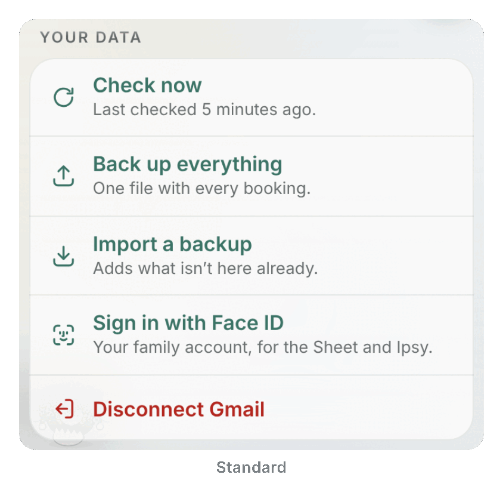

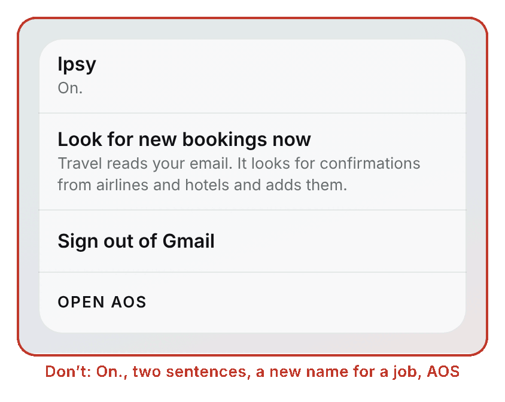

## 7. Ipsy

**Ipsy sits in the app's bottom left corner, every change it makes comes with
Undo, it asks in its own chat before anything big, its switches live in
Settings > Ipsy, and anything marked Private stays out of what it reads.**

- **Why:** a helper that changes your things has to be easy to find, easy to
  undo and easy to keep out.
- **Done:** `home/ipsy.js` mounted with `slot:` the dock's bottom left (where
  the floating way out sits while a sheet is open), never over content. A
  tool's change returns `change: { text, undo }`, which the chat shows with
  Undo; a big change asks first with the tool's `confirm(text, { yes, no })`, a
  card in the chat. Settings > Ipsy holds every Ipsy switch for the app (Ipsy
  fills in what's missing, Ipsy can search Gmail), with the models it uses in
  the line under the section. A note, order, booking or event can be marked
  Private (a switch in its editor): the app's tools leave it out of everything
  they read (`AllisonOS.ipsy.privacy`). In Tron the helper is Ares.
- **Enforced:** Review (Undo and the chat's asking are `home/ipsy.js`'s own;
  CI: `order` checks where the Ipsy section sits).
- **Known gaps:** none.

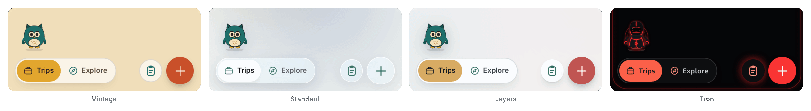

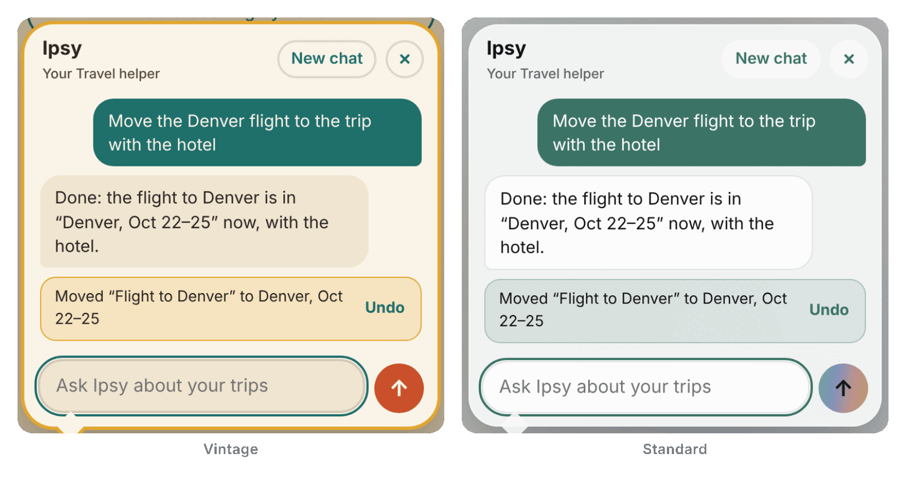

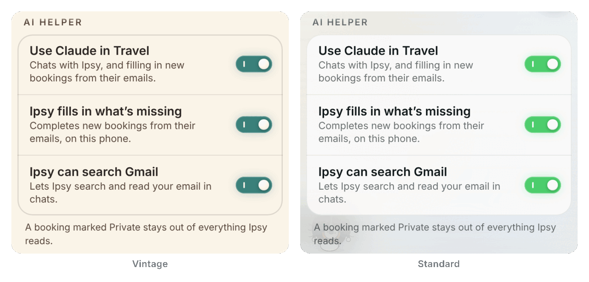

## 8. Empty screens

**An empty screen says what's missing in a few words and offers the next step
as a button.**

- **Why:** the first time you open an app is the screen you see most before
  you trust it.
- **Done:** a short line in the app's card ("No trips yet", "Nothing logged
  yet"), then the one or two ways to fill it, the main one in the look's main
  button colour. No pictures of empty boxes, no paragraphs, no "Error". What
  another app could add says so ("If you use Notes, …"), never an error.
- **Enforced:** Review.

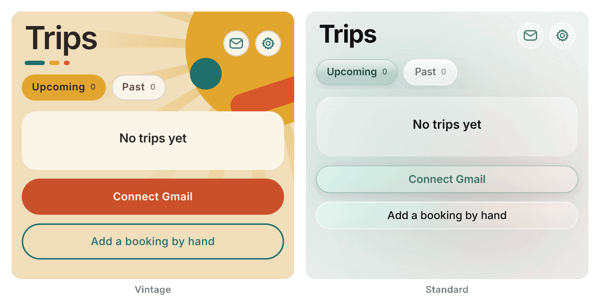

## 9. Toasts and Undo

**Say what just happened in a toast at the bottom, with Undo for anything you
can take back; don't ask first for things you can undo.**

- **Why:** asking "Are you sure?" for everything trains people to tap yes;
  Undo is faster and safer.
- **Done:** one toast element per app (`role="status"`, so VoiceOver reads it),
  above the bottom bar, gone after 4 seconds; its text a short past-tense
  sentence ("Deleted Goblet Squat."); its action button says Undo (or the one
  verb that takes it back). Deleting one thing: do it and offer Undo. Deleting
  everything, or what Undo can't bring back: the danger row (rule 5).
- **Enforced:** Review.
- **Known gaps:** Sparkle's toast isn't `role="status"`; Home's and Sparkle's
  have no Undo.

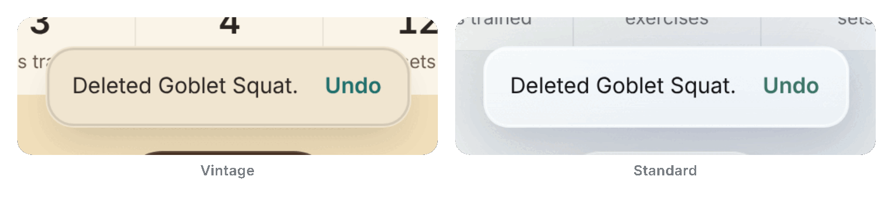

## 10. Motion and Reduce Motion

**Motion explains what happened (a sheet rises, a thumb slides); with Reduce
Motion it stops, and nothing is lost.**

- **Why:** motion that's only decoration is noise; for some people it makes
  them ill.
- **Done:** short, eased transitions (`--ease`, about .2 to .46 s); the
  sliding thumb from `home/slide.js`. Every animation and transition has a
  `@media (prefers-reduced-motion: reduce)` rule that stills it, and glass has
  a `prefers-reduced-transparency` fallback. The sky holds still, Ipsy holds a
  pose, Tron's light trail stops.
- **Enforced:** CI: `motion` (the page has a Reduce Motion rule). That it
  covers everything: Review.

## 11. Light and dark

**Every look works light and dark (Tron is dark only), from tokens, following
the phone or the person's choice.**

- **Why:** the family reads these apps in bed and in the sun.
- **Done:** dark tokens under `@media (prefers-color-scheme: dark)`, written
  once; `home/welcome.js` applies Light, Dark or Automatic (`home.settings`
  theme) by switching those media queries, so no `data-theme` copies and no
  theme switch of your own. Script that draws colours (a canvas, map tiles)
  reads `data-theme` on `<html>` and redraws on `aos:theme`. Text at 4.5:1 or
  more on its ground, both ways.
- **Enforced:** CI: `aOS/scripts/apps-smoke-test.mjs` opens every app light
  and dark. Contrast: Review.

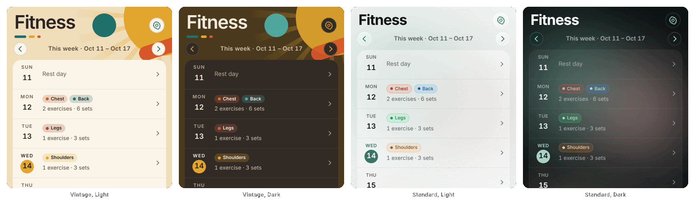

## 12. Accessibility

**Every target is at least 44 × 44, every button has a name VoiceOver can
read, and colour is never the only signal.**

- **Why:** small targets and unnamed icons lock people out; colour alone fails
  in Tron, in the sun and for the colour-blind.
- **Done:** real `<button>`s and `<label>`s; icon-only buttons carry an
  `aria-label` (Settings, Done, Back, Close). A row is the target, not the
  small control in it. On or off reads without colour (the switch's | and o);
  a state is also a word, a mark or a position. Switches are
  `role="switch"` with `aria-checked`; choices `role="radio"`.
- **Enforced:** CI: `names` (every button on the main screen and in Settings
  has a name). 44 points: Review.
- **Known gaps:** the shared choice control's
  options are 34 tall inside a taller row (`home/settings.js`): fine to tap,
  but under 44.

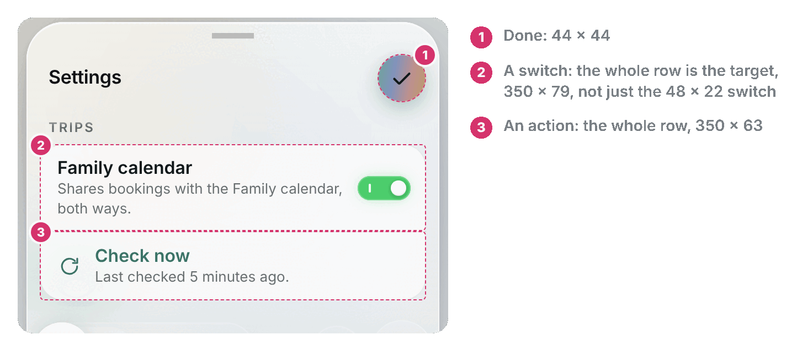

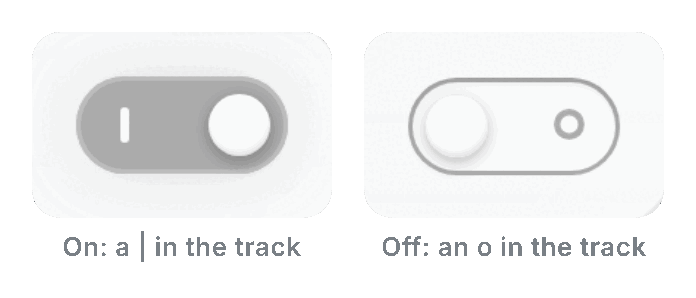

## 13. Icons

**Each app's icon is one white glyph on a full-bleed gradient in its own tint,
drawn once in `icon.svg` and generated for every look; icons inside the app
are line drawings in the accent colour.**

- **Why:** people find an app by its tint and its glyph, in every look.
- **Done:** `icon.svg` → `icon-180.png`, `icon-512.png` (Vintage) and
  `icon-glass.svg` → `icon-glass-*.png` (`scripts/make-icons.mjs`);
  `icon-layers-*` and `icon-grid-*` from `make-looks.mjs`; `home/design.js`
  swaps them with the look. A tint no other app uses; detail cut out of the
  glyph, not drawn in another colour. In the app: line icons at about 1.7
  stroke, rounded ends (`home/settings.js`'s `ICONS` for action rows), in
  `--icon` or the accent. Settings is a gear.
- **Enforced:** CI: `check-apps.mjs` (the icons exist and are current).
  The glyphs: Review.
- **Known gaps:** Drinks' Settings button is a person, not a gear.

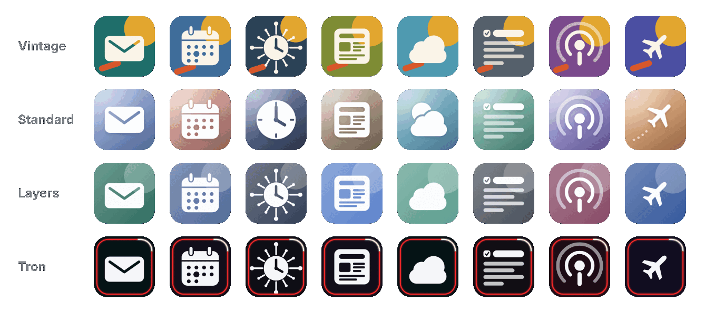

## 14. Shared parts: use `home/`, never a copy

**What every app shares lives once in `home/`; load it, don't copy it.**

- **Why:** a copy drifts; the shared part gets fixed and the copy doesn't.
- **Done:** `home/welcome.js` (walkthroughs, updates, theme, the floating way
  out), `home/design.js` (the looks; Clock's own `clock/design.js` is the one
  exception), `home/settings.js` (Settings and the switch), `home/slide.js`
  (the sliding thumb), `home/sky.js` (Vintage's sky), `home/names.js` (the
  helper's name), `home/ipsy.js` and `home/redact.js` (Ipsy),
  `home/account.js` (family sign-in), `home/sheet.js` (the family's Google
  Sheets), `home/aisles.js` (grocery sections). Each listed in the app's
  `sw.js` SHELL. Need it to do more? Change the shared part (every app gets
  it) instead of working round it in one app.
- **Enforced:** CI: `shared` and `switch-css` for Settings and the switch;
  `check-apps.mjs` for the rest of the wiring. Everything else: Review.

---

## The checks

`node aOS/scripts/design-check.mjs` (`--only mail,notes` for some apps,
`--json out.json` for the results). It opens every app at iPhone size in
Chromium, offline, opens Settings as a person would, and checks:

| Check | Rule |
|---|---|
| `shared` | 4, 5, 14: `home/settings.js` loaded before the app's script and in `sw.js` SHELL; the open sheet is its sections, and every switch in it the shared one |
| `title` | 3, 4: a button labelled Settings opens a sheet named Settings |
| `done` | 3: the ✓ labelled Done, in the head's right corner, 44 × 44 |
| `design-first` | 4: Design is the first section, with the shared picker |
| `order` | 4: the sections in the standard order |
| `on-off` | 6: no "On." or "Off." |
| `one-sentence` | 6: the line under a row is one sentence with a full stop |
| `switch-css` | 5: no private copy of the switch's CSS (n/a for Home) |
| `no-dialogs` | 5: no `confirm()`, `alert()` or `prompt()` (Ipsy's own confirm is fine) |
| `names` | 12: every button on the main screen and in Settings has a name |
| `aos-case` | 6: "aOS" never uppercased |
| `motion` | 10: a Reduce Motion rule |

aOS itself has no Settings sheet (its Account tab is the hub's own), so the
Settings checks are n/a there. CI runs it on every pull request that changes an
app or shared code (`.github/workflows/apps-check.yml`, the `standalone` group), and
it must pass.
